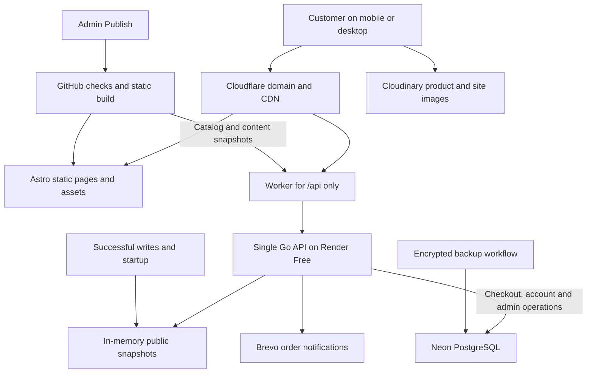

# LoverBaazar: numbered delivery and launch roadmap

Prepared 17 November 2026 from the [repository audit and local verification](architecture-audit.md). This is the owner's task list for replacing the existing Namecheap WordPress store with the current free architecture. Mobile-first storefront and admin behavior is mandatory.

## How to use this plan

Say **"Do task 1"**, **"Do task 14"**, or another task number. Each number identifies one deliverable with dependencies and acceptance checks. Existing working functionality should be verified and improved where needed; the task does not require rebuilding it from scratch.

Every task starts **Planned**. On execution, update its status to **In progress**, **Blocked** or **Done**, and add the actual files/artifacts, checks, results and remaining owner actions. Keep numbers stable. A task requiring inaccessible owner data or an account step stays incomplete until that step is verified. Do not substitute generated sample data for the real shop's acceptance evidence.

Tasks 1–42 prepare a release on local/preview infrastructure. Tasks 43–48 handle the owner-operated domain handover and hosting retirement. Task 49 establishes ongoing operation; task 50 is a future paid migration and is explicitly outside this launch. Start with task 1. Run task 31 as soon as tasks 1–8 make its dependencies available so subsequent changes benefit from CI.

The current audit is already completed and documented separately. No implementation task is marked Done merely because related features or tests already exist.

## Architecture to preserve

Browsing and builds read memory snapshots, never the database. `/api/health` never touches the database. Checkout alone validates the actual sellable stock, current prices, discounts and delivery charges transactionally. Account/private administrative reads may query the database and must never be publicly cached.

Keep domain registration at Namecheap. Move authoritative DNS to Cloudflare Free only during the prepared handover; keep WordPress answering until the website cutover. Domain transfer to another registrar is unnecessary. The owner pays only for the domain after the already-paid old hosting is retired. No card, paid tier, auto-reload or metered overage is allowed on the new stack.

Render Free can sleep and has no production availability guarantee. Free quotas can interrupt API/database/image/mail service. The plan improves correctness and graceful failure; it cannot turn free providers into an always-available paid service. Current official limits and sources are recorded in the [audit](architecture-audit.md#free-hosting-facts-checked-against-official-documentation).

## Delivery phases

| Tasks | Result |
| --- | --- |
| 1–8 | Reproducible development, contracts, security and safe publication |
| 9–16 | Mobile-first customer and admin journeys |
| 17–23 | Accurate product data and rehearsed WordPress migration |
| 24–30 | URL/SEO preservation, fast pages and accessible interactions |
| 31–37 | CI/CD, free hosting, notifications, backups and operations |
| 38–42 | Integrated testing and release approval |
| 43–48 | DNS/email handover, final data sync, domain launch and Stellar Plus retirement |
| 49 | Maintenance and measurable growth thresholds |
| 50 | Future owner-authorized VPS migration |

## Tasks 1–8: engineering foundation

### Task 1 — Make local development and testing reproducible

**Status:** Done — implemented and locally verified · **Depends on:** none

- Deliver a reliable setup/check entry point for Docker, Go, Node, dependency installation and Playwright browsers. Align the documented toolchain with CI; preserve `scripts/dev.sh` as the full-store entry point.
- Give destructive API tests a clearly separate, loopback-only disposable database and guard against selecting `lbpg`, production URLs or an ordinary development database. Bound startup waits, check port conflicts and clean up only task-owned processes/containers.
- Verify a fresh local setup, API/Worker/browser checks and cleanup. Document expected browser installation or `CHROME_PATH` use. Done when a new checkout can repeat the checks without secrets, production traffic or changes to business data.

**Implementation evidence (17 November 2026):** [Foundation report](foundation.md) and [verification results](foundation-results.md).

### Task 2 — Define and enforce application data contracts

**Status:** Done — implemented and locally verified · **Depends on:** 1

- Document product, category, stock, live/site settings, checkout, order and publication payloads. Introduce appropriately scoped types/validation at the Go and Astro/JavaScript boundaries; avoid a framework rewrite.
- Enforce bounded whole-taka integers, bounded integer stock deltas/quantities, valid slugs/URLs, category relationships and supported attributes. Reject overflow, fractions, malformed references and ambiguous product variants.
- Verify boundary inputs with meaningful API/build checks. Done when invalid persisted content cannot silently break a build or produce incorrect money/stock behavior, and contracts explain which changes are live versus Publish-required.

**Implementation evidence (17 November 2026):** [Foundation report](foundation.md) and [verification results](foundation-results.md).

### Task 3 — Separate local, preview and production behavior

**Status:** Done — implemented and locally verified · **Depends on:** 1, 2

- Provide explicit environment conventions for catalog origin, site origin, indexing, bot checks, notification recipients and uploads. Production must refuse local tokens and unsafe development settings.
- Keep repeatable integration environments local in Docker. Use a free Worker preview with fixtures or a deliberately isolated data source; never run destructive tests or real customer notifications against the production database. Avoid a second continuously running Render service.
- Add preview `noindex` headers/meta and keep private/admin/customer data protected independently of indexing. Verify preview/prod builds, canonical origins, secret isolation and forbidden configuration combinations.

**Implementation evidence (17 November 2026):** [Foundation report](foundation.md) and [verification results](foundation-results.md).

### Task 4 — Secure repository, accounts and secrets

**Status:** In progress — repository work complete; account/cloud verification pending · **Depends on:** 1

- Inventory secrets by owning service, scope and rotation procedure without recording values. Check tracked files/history for accidental credentials and private customer exports; rotate confirmed exposures through owner-operated dashboards.
- Prepare least-privilege GitHub/Cloudflare/Render access, 2FA/recovery ownership, restricted production secrets, minimal workflow permissions, pinned third-party action revisions and dependency update/security checks that remain free.
- Define branch protection or the available free equivalent and a token-expiry recovery procedure. Verify untrusted pull requests cannot access deploy/backup secrets. Account changes requiring owner access remain explicit pending steps.

**Implementation evidence (17 November 2026):** [Foundation report](foundation.md) and [verification results](foundation-results.md). GitHub 2FA and read-only workflow defaults were verified. Main protection enforces Store CI on current pull requests, including for administrators. Other provider account and recovery checks remain owner actions.

### Task 5 — Harden API, admin and customer privacy boundaries

**Status:** Done — implemented and locally verified · **Depends on:** 2, 3, 4

- Review origin authentication, trusted client IPs, admin authentication/storage, customer cookies, CSRF and request content types, input/body limits, upload content validation, safe HTML/URL handling and abuse limits. Preserve guest checkout and allow legitimate shared mobile-network addresses.
- Ensure all private/error responses have correct cache behavior and logs do not leak addresses, credentials, payment references or tracking queries. Verify JSON-LD serialization and `esc()` use at customer-text boundaries.
- Require a coherent production Turnstile configuration and test rejection/expiry/retry paths with test keys or stubs. Done with targeted negative tests for actual trust boundaries, not only happy-path login tests.

**Implementation evidence (17 November 2026):** [Foundation report](foundation.md) and [verification results](foundation-results.md).

### Task 6 — Prove checkout, money and inventory correctness

**Status:** Done — implemented and locally verified · **Depends on:** 2, 5

- Preserve database-authoritative prices, delivery/coupon calculation, relative stock updates and transaction-only queries. Check monetary overflow and all-or-nothing rollback across multi-product carts.
- Strengthen idempotency behavior across lost responses, concurrent retries and changed payloads; scope keys so a reused key cannot reveal another customer's receipt. Verify coupon/payment-reference limits, logged-in pool contention, cancellation/return stock restoration and concurrent admin stock deltas.
- Extend existing tests only for uncovered risks. Done when race/concurrency tests prove the last unit sells once, retries create one order and a failed transaction leaves no partial order, stock or coupon changes.

**Implementation evidence (17 November 2026):** [Foundation report](foundation.md) and [verification results](foundation-results.md).

### Task 7 — Make schema changes, startup and readiness reliable

**Status:** Done — implemented and locally verified · **Depends on:** 2, 3

- Establish versioned, repeatable database changes with a migration lock, clear failure reporting and compatibility rules for rolling back application code. Preserve one-time content updates and owner-edited content.
- Expose release/version and readiness information from memory after migration/snapshot initialization. Keep `/api/health` database-free; do not add database probes to public browsing or routine uptime checks.
- Test clean schema creation, upgrade from an earlier schema, concurrent/repeated startup, migration failure and database wake/failure. Done when deploy checks distinguish a live process from a store ready to accept requests.

**Implementation evidence (17 November 2026):** [Foundation report](foundation.md) and [verification results](foundation-results.md).

### Task 8 — Make publishing and image cleanup safe

**Status:** In progress — repository work complete; account/cloud verification pending · **Depends on:** 6, 7

- Persist saved/published content revision state and associate a build/deployment with its input revision and code version. Show queued, running, failed and confirmed published results; dispatch acceptance must not clear pending changes.
- Define a consistent catalog/content snapshot for builds. Preserve Publish-required editorial edits when refreshing live price/stock information; a price refresh must not publish unrelated pending names, pages or photos.
- Retain images used by the active release and rollback releases. Delete only after confirmed replacement publication and a bounded retention policy, with quota accounting.
- Verify failed/cancelled/superseded builds, another-device admin access, edits during a build, replaced photos before Publish and a rollback. Existing public pages must retain working assets throughout.

**Implementation evidence (17 November 2026):** [Foundation report](foundation.md) and [verification results](foundation-results.md). Real isolated local success/failure/retry and protocol regression checks pass. On 18 November, the [admin-triggered publication](https://github.com/saif-sakib/loverbaazar/actions/runs/44136254142) and [latest main release](https://github.com/saif-sakib/loverbaazar/actions/runs/44202649487) passed deployment confirmation. The Cloudflare preview returned the matching main commit as JSON. Cross-device confirmation, asset replacement and hosted rollback remain pending.

**Product photo follow-up.** Gallery and description selections stay in the browser until a product save. A checked save uploads only referenced files, preserves retries and tracks interrupted uploads for compensation. Rollback and shared images remain protected. A disposable trial on the Cloudinary Free account verified served upload, idempotent retry, replacement and confirmed removal of both fixture assets. Historical assets without verified ownership remain queued for review. Deployment and hosted admin smoke test are pending.

## Tasks 9–16: mobile-first UI and UX

### Task 9 — Establish the mobile design system

**Status:** Done — implemented and locally verified · **Depends on:** 1

**Implementation evidence (18 November 2026):** [Mobile UI report](mobile-ui.md) and [verification results](mobile-results.md).

- Document and implement shared spacing, type, colors, controls, page widths, focus and loading/error/empty states. Start at 320–414 px, then enhance with tablet/desktop breakpoints.
- Prefer `min-width` for new/substantially rewritten layout rules and consolidate competing overrides where the change requires it. Preserve existing brand assets and useful mobile controls.
- Require readable forms, practical 44 × 44 px touch targets, contrast, 200% zoom, reduced motion and safe-area support. Verify 320/360/375/390/414/768/1024/1440 px without page-level overflow. Record representative mobile screenshots as design evidence.

### Task 10 — Improve mobile home, navigation and search entry

**Status:** In progress — implementation and local checks complete; real-phone acceptance pending · **Depends on:** 9

**Implementation evidence (18 November 2026):** [Mobile UI report](mobile-ui.md) and [verification results](mobile-results.md).

- Make categories, product discovery, search, offers, cart and contact easy to reach with one hand. Reduce unnecessary first-screen hero height and competing sticky/floating controls while keeping the current visual identity.
- Support touch/keyboard category navigation, clear active states, useful search suggestions and honest delivery/payment messages driven by settings.
- Verify narrow phones, landscape, software keyboard, slow loads and navigation back/forward. Done when a new mobile customer can find a category or product quickly and primary controls remain visible without overlays or hover dependence.

### Task 11 — Improve catalog, filtering and search results

**Status:** Done — implemented and locally verified · **Depends on:** 9, 10

**Implementation evidence (18 November 2026):** [Mobile UI report](mobile-ui.md) and [verification results](mobile-results.md).

- Refine cards, stock/price clarity, sorting, price/stock filters and accessible mobile filter controls. Add brand/color filters only where task 2's real attributes support them; do not invent unavailable variants.
- Preserve useful filter state on navigation, provide clear reset/no-result/error states and ensure live price updates preserve sorting. Keep every sellable product reachable with crawlable links; use static pagination when catalog size warrants it.
- Verify long English/Bangla names, no results, hidden/deleted products, stale stock, many products and keyboard use. Filter/query URL rules must align with task 24's canonical/indexing policy.

### Task 12 — Improve product details and purchase decisions

**Status:** In progress — implementation and local checks complete; real-phone acceptance pending · **Depends on:** 9, 11

**Implementation evidence (18 November 2026):** [Mobile UI report](mobile-ui.md) and [verification results](mobile-results.md).

- Refine gallery/zoom, real specifications, model/SKU, brand, included items, warranty/returns, availability, quantity and delivery information. Identify seller and manufacturer accurately; show no fabricated ratings, warranty or stock promises.
- Keep Add to cart/Buy now understandable and reachable on phones. Resolve buy-bar/navigation/chat overlap and include accessible image/option controls. Unsupported selectable product options block that product's launch until represented correctly.
- Verify photo failures, long text, out-of-stock states, selected options and keyboard/touch zoom. Done when customers can decide what is being sold and what delivery/payment will require before checkout.

### Task 13 — Refine cart, wishlist and saved shopping state

**Status:** Done — implemented and locally verified · **Depends on:** 9, 11

**Implementation evidence (18 November 2026):** [Mobile UI report](mobile-ui.md) and [verification results](mobile-results.md).

- Make quantity editing, removal, price changes, stock limits and the route to checkout clear on phones. Keep wishlist/recent products useful without making an account mandatory.
- Preserve valid state across reloads/tabs and tolerate malformed or blocked browser storage. Explain removed products and price/availability changes without implying the browser's total is authoritative.
- Verify empty carts, stale catalog entries, cross-tab changes, lost connectivity, storage denial and mobile touch targets. Done when shopping state recovers gracefully and checkout receives only product IDs/options and quantities.

### Task 14 — Finish the Bangladesh guest checkout journey

**Status:** In progress — implementation and local checks complete; real-phone acceptance pending · **Depends on:** 6, 12, 13

**Implementation evidence (18 November 2026):** [Mobile UI report](mobile-ui.md) and [verification results](mobile-results.md).

- Refine labels, Bangladeshi phone normalization, address/delivery selection, optional email, coupons, per-piece delivery charges, payment instructions and final server-confirmed totals. Keep guest ordering the default path.
- Clearly label manual mobile payments as requiring verification. Handle Turnstile expiry, duplicate taps, total/stock changes, slow API wake-up and an uncertain response without encouraging a second payment or duplicate order.
- Verify saved form input on recoverable errors, focus/error announcements, mobile keyboard and confirmation/tracking. Done when the full flow succeeds on phones and failure states retain a safe, understandable recovery path.

### Task 15 — Finish account, tracking, contact and policy journeys

**Status:** Done — implemented and locally verified · **Depends on:** 5, 9, 14

**Implementation evidence (18 November 2026):** [Mobile UI report](mobile-ui.md) and [verification results](mobile-results.md).

- Refine optional registration/login/logout/password changes, phone-based order tracking and contact/review forms. Explain that historical WordPress passwords/sessions may not transfer; keep the agreed account recovery method safe and understandable.
- Link actual delivery, returns, warranty, privacy and terms content at decision points. Keep public tracking responses limited to the matched customer and keep admin notes private.
- Verify wrong-phone tracking, expired sessions, abuse errors, duplicate submissions, screen-reader labels and Bangla input. Done when support journeys work without requiring paid SMS, a new mailbox service or customer login for purchase.

### Task 16 — Finish mobile admin workflows

**Status:** In progress — implementation and local checks complete; real-phone acceptance pending · **Depends on:** 8, 9

**Implementation evidence (18 November 2026):** [Mobile UI report](mobile-ui.md) and [verification results](mobile-results.md).

- Make products, images, stock deltas, prices, categories, pages, site/live settings, coupons, orders, tracking, messages and customer support usable from a phone. Use contained table scrolling or readable row layouts as appropriate.
- Preserve unsaved edits, prevent duplicate saves, distinguish live effects from Publish-required effects and display task 8's real publication status. Provide clear order/payment verification and safe CSV export behavior.
- Verify 320–414 px widths, slow/error responses, concurrent edits, image replacement, cancel/return actions and form navigation. Done when the owner can update stock and fulfill an order from a real phone with no clipped primary actions.

## Tasks 17–23: real data, content and migration

### Task 17 — Capture the WordPress and hosting inventory

**Status:** In progress — export/inventory tooling verified; selected data export pending · **Depends on:** 3, 4

**Implementation evidence (18 November 2026):** [Migration runbook](migration.md), [verification results](migration-results.md) and [private export instructions](wordpress-export.md).

- Obtain the selected private WooCommerce catalog/order records, Rank Math metadata/redirects and required media/URL sources. The owner waived a full WordPress filesystem and MySQL backup on 18 November 2026. Capture the current DNS zone, mailbox/other-site inventory and Stellar Plus renewal/end dates.
- Record source time, file checksums, actual record counts, unresolved fields and business-critical legacy URLs. Keep raw exports/customer details outside Git and public CI artifacts; commit only sanitized tooling and aggregate evidence.
- Verify exports are readable and identify which historical orders remain unfulfilled. Done with a reproducible source manifest and exact missing-data actions for the owner, not an assumed fixed product count.

### Task 18 — Build a repeatable, validated catalog importer

**Status:** In progress — validated importer and isolated checks complete; actual catalog acceptance pending · **Depends on:** 2, 7, 17

**Implementation evidence (18 November 2026):** [Migration runbook](migration.md), [verification results](migration-results.md) and [private export instructions](wordpress-export.md).

- Replace fixed-page/minor-unit assumptions with a complete paginated/export-based import that validates currency, source precision, IDs, slugs, categories, attributes, images and real quantities. Support dry run, change report, explicit create/update policy and safe reruns.
- Map variable products to supported independent SKU/option inventory or block unresolved products. Respect sold-individually, unmanaged stock/backorders and inactive items; never translate an in-stock flag into 100 sellable units.
- Verify against isolated PostgreSQL with duplicate, missing, fractional, encoded Bangla, out-of-stock and variant fixtures. Done when reruns are idempotent and proposed updates cannot overwrite later admin edits or sales silently.

### Task 19 — Preserve customers and legacy orders safely

**Status:** In progress — private archive/journal verified; actual coverage and obligation approval pending · **Depends on:** 5, 17, 18

**Implementation evidence (18 November 2026):** [Migration runbook](migration.md), [verification results](migration-results.md) and [private export instructions](wordpress-export.md).

- Deliver a tested historical migration or searchable private archive with explicit owner-approved coverage. Preserve original identifiers, statuses, timestamps, totals and outstanding fulfillment obligations; map legacy statuses to documented meanings.
- Do not replay historical orders through checkout or decrement current stock again. Account mapping must verify identity; never claim WooCommerce password hashes work with the current password scheme or automatically attach a person's orders merely because someone registered a matching number.
- Verify counts/totals, privacy, duplicate imports and account recovery. Done when the owner can fulfill and support old orders and each excluded data class has a recorded archive/disposition, including when the source contains no such records.

### Task 20 — Move every required asset off WordPress hosting

**Status:** In progress — asset pipeline and redirects verified locally; real transfers/quota acceptance pending · **Depends on:** 8, 17, 18

**Implementation evidence (18 November 2026):** [Migration runbook](migration.md), [verification results](migration-results.md) and [private export instructions](wordpress-export.md).

- Extend/verify `images_to_cloudinary.py` for product, embedded description, category, page, blog and site assets. Keep deterministic `loverbaazar/products/<category>/<product>-N` naming and corresponding `pages/`, `blog/`, `site/` locations.
- Create a resumable manifest with source/destination checks, useful alt text, dimensions and explicit failures. Preserve required downloads and old image URL mappings; implement appropriate legacy asset redirects before removing their old host.
- Verify real downloads/delivery, image replacement rollback and zero required references to Namecheap `/wp-content/` or hosting-only assets. Account for retained originals/variants against the free quota. A product-only image count is insufficient.

### Task 21 — Reconcile and approve the sellable product database

**Status:** In progress — protected review/apply workflow ready; actual stock approval pending · **Depends on:** 16, 18, 20

**Implementation evidence (18 November 2026):** [Migration runbook](migration.md), [verification results](migration-results.md) and [private export instructions](wordpress-export.md).

**Live audit, 18 November 2026.** The isolated restore of the production archive contained 291 active catalog entries. Of those, 267 had exactly 100 units, the historical seed quantity. Confirm these against actual stock before relying on them for sales.

- Produce a product-by-product review of real names/models, category, SKU/options, stock quantity, current/regular price, description, specifications, images, warranty and active status. Resolve duplicates, placeholder content, missing photos and unsupported options.
- Give the owner a practical review/import/admin-edit process. Capture corrections as safe deltas or a controlled prelaunch reconciliation, never a blind stock overwrite during sales.
- Compare approved records with the target database and build inputs. Done only when the owner approves the actual catalog and every launch product has verified price/stock; a successful old seed import does not satisfy this task.

### Task 22 — Finish truthful brand, policy and editorial content

**Status:** In progress — editorial audit and approval prepared; business-content approval pending · **Depends on:** 10, 12, 15, 17

**Implementation evidence (18 November 2026):** [Migration runbook](migration.md), [verification results](migration-results.md) and [private export instructions](wordpress-export.md).

- Review shop identity, phone/address/hours, delivery areas/charges/times, enabled payment accounts, warranty/returns/refunds, About/How to Buy/Terms/Privacy, category introductions and useful buying guides. Keep defaults only in `defaults.json`, with owner changes managed in admin.
- Remove template/demo claims and stale WordPress shortcodes. Preserve valuable Bangla/English content and make language metadata reflect actual content. Do not publish invented testimonials or unverified brand guarantees.
- Verify internal links, contacts and policy consistency with checkout. Record owner approval of commercial promises; use new one-time content-update IDs for applicable seeded-content fixes without overwriting rewrites.

### Task 23 — Rehearse migration and final-delta reconciliation

**Status:** In progress — synthetic rehearsal and restore passed; real-data rehearsal and restore point pending · **Depends on:** 18, 19, 20, 21, 22

**Implementation evidence (18 November 2026):** [Migration runbook](migration.md), [verification results](migration-results.md) and [private export instructions](wordpress-export.md).

- Run the full migration against an isolated copy, then rerun it and simulate changes arriving on WordPress after the first export. Produce a dry-run delta for final prices, quantities, catalog edits and outstanding orders.
- Reconcile source/target counts, identifiers, order totals/statuses, relationships, Asia/Dhaka display and image mappings. Document an explicit source-of-truth switch and single-writer freeze, including how old orders fulfilled after launch affect inventory.
- Verify the script cannot import over postlaunch sales or resurrect deliberately removed content. Done with an exception-free rehearsal or individually approved exceptions, a restore point and a measured cutover procedure.

## Tasks 24–30: SEO, performance and accessibility

### Task 24 — Preserve legacy URLs and define redirects

**Status:** In progress · **Depends on:** 17, 18

- Build a URL ledger from WordPress exports, sitemaps and available Search Console/backlink/traffic exports. Preserve exact product/category/tag/page/post paths, nested categories, trailing slashes and percent-encoded Bangla through `fileSlug()`.
- Map changed URLs and legacy images/downloads to their closest relevant destinations; retain useful old query-link behavior. Review broad existing redirects for soft-404s. Genuine missing resources return an actual 404/410, without universal homepage redirects or redirect chains.
- Define HTTPS, apex/www, canonical query/filter and staging URL policies. Verify the complete ledger, unusual encodings, redirects and status codes; protect commercially important URLs with regression checks.

**Evidence, 18 November 2026.** Public sitemap ledger and exact path/query aliases implemented. Local comparison covered 348 URLs, with 336 direct, eight equivalent alias redirects, and four private decisions pending. The implemented aliases use public WordPress sitemap evidence. Complete private Search Console/backlink and catalog archive coverage. [Results and remaining actions](seo-performance-results.md)

### Task 25 — Finish on-page SEO and indexing rules

**Status:** In progress · **Depends on:** 22, 24

- Preserve useful Rank Math titles/descriptions/canonicals and provide editable SEO fields with sensible per-page fallbacks. Improve headings, category text, internal links, descriptions, actual language metadata, social images and article information without repetitive keyword stuffing.
- Align sitemap inclusion with canonical/indexable active content, excluding admin/account/cart/checkout/search/tracking, drafts and intentional noindex pages. Make preview indexing protection environment-aware and preserve Search Console verification.
- Verify unique meaningful titles/descriptions, one primary H1, canonical correctness, noindex/robots behavior and valid share images. Do not claim robots disallow makes private data secure or reliably removes an already indexed URL.

**Evidence, 18 November 2026.** Editable product/category/page/post search properties, preview protection, canonical build checks and production sitemap generated from page heads. Local production-shaped build passed. The custom domain initially served a preview artifact with a sitemap 404. The [production release](https://github.com/saif-sakib/loverbaazar/actions/runs/44290572989) served a valid sitemap index, a child sitemap with 571 canonical URLs and the sitemap directive in robots.txt. Search Console submission and business metadata approval remain pending. [Results and remaining actions](seo-performance-results.md)

### Task 26 — Make product structured data and feeds trustworthy

**Status:** In progress · **Depends on:** 8, 21, 25

- Validate Product/Offer/Breadcrumb/Store/Article JSON-LD and RSS/merchant feeds. Use real brand/model/SKU/GTIN where available, BDT, accurate stock, legitimate approved reviews, policy data and absolute image URLs. Omit unknown identifiers rather than inventing them.
- Implement a documented freshness policy for build-time prices/availability and feeds. Rebuild already-published content or serve appropriate memory-snapshot feeds without releasing pending editorial edits. Include the trigger, maximum lag and failure alert; a browser price patch alone does not update static HTML.
- Verify rich-result validation, feed parsing and a price/stock change across HTML, visible UI and feeds. Confirm channel/country eligibility before treating Merchant Center as a required sales channel. Google indexing timing is outside the application's control.

**Evidence, 18 November 2026.** BDT Product/Offer fields, verified GTIN handling, separate blog/product RSS and opt-in daily published-offer refresh implemented. Local frozen-release and artifact-change checks passed. Final rich-results test, real offer reconciliation and hosted workflow evidence are pending. [Results and remaining actions](seo-performance-results.md)

### Task 27 — Optimize images, fonts and mobile rendering

**Status:** In progress · **Depends on:** 12, 20

- Deliver correctly sized Cloudinary responsive images with constrained transformation widths, useful `srcset`/`sizes`, modern formats, reserved dimensions and eager/high-priority loading only for real above-fold/LCP images. Lazy-load the remainder.
- Reduce unused font weights/subsets while retaining Bangla/English glyph coverage and stable fallback layout. Verify broken-image handling, zoom quality and gallery sizing.
- Measure mobile network/image transfers and layout shift on home, category and product pages. Done with recorded before/after evidence and acceptable Cloudinary credit use; do not trade an oversized original for uncontrolled per-device transformation costs.

**Evidence, 18 November 2026.** Bounded responsive Cloudinary image URLs, priority/lazy loading, gallery zoom and self-hosted Latin/Bangla fonts implemented. Fixture measurements completed. The live catalog exposed 291 products with Cloudinary galleries. The Cloudinary Free account reported 6.64% of its credits in use during the audit. Confirm visual quality and complete archival coverage. [Results and remaining actions](seo-performance-results.md)

### Task 28 — Set and meet frontend performance budgets

**Status:** In progress · **Depends on:** 10, 11, 27

- Measure representative pages on throttled mobile hardware/network profiles, then reduce blocking work, unnecessary JavaScript/CSS, long tasks, excessive DOM/card rendering and full-index downloads where justified. Keep Astro static output and avoid adding a frontend runtime without evidence.
- Initial targets: ordinary storefront first-load transfer ≤1 MB, compressed first-party JS ≤75 KB and CSS ≤40 KB, with separately recorded image/font budgets. Adjust targets only with documented measurements and a reason; do not hide regressions by changing thresholds silently.
- Target LCP ≤2.5 s, INP ≤200 ms and CLS ≤0.1; lab measurements are prelaunch evidence, field 75th-percentile results come later. Verify cold/warm cache and meaningful input interactions. [Metric definitions](https://web.dev/articles/vitals)

**Evidence, 18 November 2026.** Repeatable cold/warm phone-profile lab and documented byte thresholds. All representative fixture pages passed. The hosted homepage, shop, anodized category and induction product measured 166–386 kB cold transfer and 0.93–1.51 s lab LCP. Collect real-device and field results when eligible. [Results and remaining actions](seo-performance-results.md)

### Task 29 — Add useful, private and free measurement

**Status:** In progress · **Depends on:** 25, 28

- Prepare Search Console ownership/sitemap monitoring and minimal free analytics or aggregate counters appropriate to the owner's questions. Track product discovery, checkout attempts/success and failures without recording names, phone numbers, addresses, transaction IDs or secrets.
- Make optional analytics respectful of applicable consent/privacy choices; a blocked analytics script must never break shopping. Use provider dashboards or lightweight aggregate tooling before adding a new service.
- Verify duplicate purchase events/idempotent retries and exclusion of preview/test traffic. Done with a baseline/report guide for conversion, popular products, 404s and Web Vitals, stating where low traffic means field data is unavailable.

**Evidence, 18 November 2026.** Documented Search Console/404/field baseline. Optional production-only request and unique committed-order counts tested with retries and no customer fields. Ownership, hosted reporting and baseline traffic remain pending. [Results and remaining actions](seo-performance-results.md)

### Task 30 — Complete accessibility and Bangla/English usability

**Status:** In progress · **Depends on:** 10, 11, 12, 13, 14, 15, 16, 22

- Audit semantics, headings, landmarks, labels, focus management, dialogs, status/error announcements, contrast, target sizes, zoom/reflow, reduced motion and keyboard navigation across shopping and admin. Use [WCAG 2.2 AA](https://www.w3.org/TR/WCAG22/) as the implementation target.
- Check Bangla numerals/phone entry, mixed-language long names, address wrapping, font coverage and clear local currency/date presentation. Do not add a partially translated language switcher that promises unsupported content.
- Verify with automated accessibility checks plus manual keyboard/screen-reader and 200% zoom checks. Done when critical journeys have no unresolved serious accessibility barriers and any remaining limitations are recorded.

**Evidence, 18 November 2026.** Resolved automated contrast, accessible naming and link issues. Axe, keyboard/reflow and disposable Bangla guest checkout passed. The hosted public-page and admin sign-in scan also reported zero tested violations. Finish real 200% zoom, TalkBack/VoiceOver and final content checks. [Results and remaining actions](seo-performance-results.md)

## Tasks 31–37: CI/CD, hosting and DevOps

### Task 31 — Enforce complete pull-request CI

**Status:** Done · **Depends on:** 1, 4, 5, 6, 7, 8

- Add pull-request and main-branch checks for Go formatting/vet/tests, targeted race coverage, JS syntax, Worker tests, deterministic Astro build/content validation and the browser suite. Run databases only in disposable CI services, with no deploy secrets or production data.
- Install/cache the supported browser/toolchain reliably. Keep routine checks bounded; place expensive browser matrices or load checks on appropriate manual/scheduled jobs. Retain only sanitized diagnostic artifacts with short retention.
- Verify a deliberate failing API/Worker/UI/build check blocks release, fork PRs have no secret access, and the intended branch rules protect deployment. Existing main-only API tests remain useful until this gate is ready.

**Evidence, 18 November 2026.** Added reusable, read-only Store CI for pull requests and main code releases. It covers Go races, API and Worker tests, migration, browser, accessibility and encrypted restore. [GitHub CI passed](https://github.com/saif-sakib/loverbaazar/actions/runs/44208908427). GitHub requires its check on up-to-date main pull requests, including administrators. An [intentional failure](https://github.com/saif-sakib/loverbaazar/pull/15) was blocked before the disposable PR was closed. The code-release workflow requires successful CI.

### Task 32 — Coordinate API and storefront releases

**Status:** Done · **Depends on:** 8, 31

- Release only tested revisions, coordinating Render API deployment/readiness, backward-compatible schema changes and Cloudflare store/Worker deployment. Prevent independent auto-deploy from bypassing checks or racing incompatible frontend/API versions.
- Build and validate a specific catalog/content revision; record commit, artifact hash, release ID and deployment status. Separate content-only publication from code release while reusing required artifact/data checks. Serialize final promotions so an old build cannot replace a newer one.
- Verify failed API readiness, failed content fetch/build, cancelled publish and failed promotion keep the previous working release. Rehearse code/asset rollback without restoring or discarding current customer orders.

**Evidence, 18 November 2026.** Added exact-commit Render/API readiness gates and serialized Cloudflare version upload, artifact fingerprint, promotion and guarded rollback. Local tests covered stale and failed candidates. The [coordinated photo release](https://github.com/saif-sakib/loverbaazar/actions/runs/44286387664) passed on the same Worker and Render revision. The [production release](https://github.com/saif-sakib/loverbaazar/actions/runs/44290572989) matched the API and Worker revisions and confirmed the live artifact. CI exercised guarded rollback without replacing orders.

### Task 33 — Configure and verify the free hosting accounts

**Status:** In progress · **Depends on:** 3, 4, 32

- Prepare reviewable configuration/manifests for Cloudflare assets/Worker, one Render Free API, Neon in a suitably nearby region, Cloudinary, Brevo and GitHub. Supply a dashboard-by-dashboard configuration checklist with secret names only. Implement through existing authorized account access or leave precise owner steps.
- Verify actual account tiers, no payment method/add-ons, limits, TLS, origin secret, custom/preview hostname behavior, static headers/redirects, bot hostnames and catalog build access. Record intended free failure behavior, asset/file limits and the keep-alive cron's quota/terms implications.
- Smoke-test the preview deployment and production-safe configuration. Update `docs/go-live.md` with current instructions and remove stale fixed counts/email assumptions. Do not change Namecheap DNS or attach the live domain in this task.

**Evidence, 18 November 2026.** Added a reviewable existing-service configuration, Free asset checks and current preview probe. The live custom domain served HTTPS and returned the matching API/Worker revision. Provider APIs verified Cloudflare zone Free, Render Free in Singapore with auto-deploy off, Cloudinary Free and Brevo Free. Neon and payment-method checks still require the owner’s dashboard.

### Task 34 — Make order notifications observable and recoverable

**Status:** In progress · **Depends on:** 5, 6, 33

- Configure the verified sender, owner recipient and optional customer confirmation. Use the shop's real settings and authenticated sender/domain configuration where applicable; distinguish outbound transactional mail from an inbound mailbox.
- Record notification outcome and support bounded retry/manual resend with deduplication, preferably in the existing database/process without paid queues or continuous polling that prevents Neon sleep. Committed orders remain successful even when Brevo is down or its quota is reached.
- Verify failure, retry, owner/customer recipient isolation and quota accounting using controlled addresses. Done when the owner sees pending/failed notifications and can recover them without duplicating orders or leaking customer data.

**Evidence, 18 November 2026.** Added transactional queued notifications, owner/customer isolation, accepted/failed/uncertain tracking, bounded retries and daily cap, plus an Admin operations view. Controlled provider simulations passed. Configure the sender and verify delivery to the owner’s test inbox.

### Task 35 — Make backups complete, private and dependable

**Status:** In progress · **Depends on:** 4, 7, 33

- Improve encrypted database backup verification, bounded retention, failure visibility and missing-schedule detection. Include restoration metadata, schema/code revision and asset/config manifests; preserve required original media separately within approved free storage.
- Keep backup keys recoverable outside the hosting accounts/repository and raw dumps out of public artifacts/logs. Check actual artifact quotas/access and the public-repository scheduled-workflow inactivity rule; provide an owner-operated offline backup fallback.
- Verify dump/encryption failures, a corrupt/empty artifact and expiry cleanup. Proposed baseline recovery point objective is ≤24 hours of data loss, subject to owner acceptance; do not imply nightly backups provide zero-loss recovery.

**Evidence, 18 November 2026.** Added verified encrypted new-store snapshots, seven-day artifact retention, and a separate freshness check and offline command. Local corruption, weak key, empty and dump-failure checks passed. The [current nightly workflow](https://github.com/saif-sakib/loverbaazar/actions/runs/44290663888) created a verified encrypted PostgreSQL 18 archive and the [freshness check](https://github.com/saif-sakib/loverbaazar/actions/runs/44290882632) passed. Keep a separate offline copy and recovery key and retain required originals.

### Task 36 — Rehearse restore, rollback and incident recovery

**Status:** In progress · **Depends on:** 8, 23, 35

- Restore an encrypted backup into a disposable database from owner-held keys, then verify orders, amounts, inventory, settings/content and image references. Record elapsed time; initial recovery-time target is ≤2 hours, confirmed or revised from the exercise.
- Write procedures for lost credentials, Render restart, Neon suspension, failed migration, bad release, corrupt content and missing images. Separate code rollback, domain rollback and disaster restore; freeze/reconcile writes before any data replacement.
- Simulate orders created after a backup and prove the recovery plan explicitly preserves/reconciles them. Done with a successful restore report and exact commands/owner steps, not only a green backup job.

**Evidence, 18 November 2026.** Restored a verified encrypted backup into an isolated empty PostgreSQL database in one to two seconds in the fixture. Verified totals, stock, settings/content/media and the later source order. Exercised guarded Worker rollback with simulated provider state and independently decrypted and restored the actual hosted archive into a disposable loopback PostgreSQL 18 database. Confirm the owner can retrieve the offline archive and key.

### Task 37 — Add operational visibility, quotas and failure handling

**Status:** In progress · **Depends on:** 28, 29, 33, 34, 35, 36

- Add request/release IDs, sanitized structured errors, lightweight readiness and counters for checkout failures, publish state and notification/backup failures. Uptime checks hit database-free health/readiness; no stock polling or monitor may wake Neon unnecessarily.
- Define quota reviews and warnings at roughly 70/85/95% with service-specific remedies, including storage, CU-hours, egress, Worker requests/CPU, image credits, email sends and Actions artifacts/runs. Alerts do not authorize payment or upgrades.
- Exercise origin sleep/down, missing snapshots, exhausted API access, stale price/stock and closed ordering. Record warm/cold latency and the free-stack availability limitation. Done when customers get a recovery path and the owner knows what failed, who acts and how to stay within $0.

**Evidence, 18 November 2026.** Added request references, sanitized API failure logs, API/admin counters, asset-aware stock cache and upstream retry responses. Removed automatic keep-awake traffic from code and documented quota responses. The apex returned a retryable 503 during one warm-up and later returned ready with the matching API revision. Provider checks confirmed several free tiers and the hosted backup freshness alert. Dashboard quota and owner notification checks remain pending.

## Tasks 38–42: release verification

### Task 38 — Test complete purchase and publication workflows

**Status:** Done · **Depends on:** 14, 16, 23, 31, 34

- Add targeted full-stack browser scenarios through `dev.sh`/the Worker and a separate disposable database, beyond the existing mocked UI checks. Use controlled email/Turnstile test integration and real application endpoints.
- Exercise browse → product → cart → guest/logged-in checkout → confirmation → tracking → admin fulfillment/cancellation; cover coupons/manual payment and notification failure. Exercise product/photo/category/page changes → save → Publish → actual release confirmation.
- Verify persisted totals, stock, order events, public snapshots and release assets after each significant transition. Done when both purchase and publication work across their real components without production writes or external customer messages.

**Evidence, 18 November 2026.** `./scripts/test-mobile.sh --ci` exercises real saves, photos, category and page publication, a matching Worker publication ID, guest checkout, tracking, fulfillment, and an authenticated coupon/manual-payment order with a lost response. The retry returns the same receipt with one stock and coupon deduction. Controlled Go provider simulations cover Turnstile and failed, uncertain and retried notifications. All writes used a disposable store.

### Task 39 — Complete browser and real-phone acceptance

**Status:** In progress — browser matrix passed; physical phones pending · **Depends on:** 27, 28, 30, 38

- Run Chromium/Firefox/WebKit checks where supported, then have the owner or tester exercise real Android Chrome and iPhone Safari. Emulation is supporting evidence, not a substitute for these device checks.
- Cover 320/360/375/390/414 px phones, tablet/desktop, portrait/landscape, zoom, screen-reader/keyboards, weak mobile networks, denied storage and interrupted connections. Test image rendering rather than aborting images in every scenario.
- Record device/browser, scenario and result with sanitized screenshots. Done when buying, tracking and the owner's common admin actions pass with readable controls and no overlays, sideways page scroll or unresolved critical browser failures.

**Evidence, 18 November 2026.** Chromium 159, Firefox 159 and WebKit 27.2 passed six routes at eight sizes, including 320–414 px, landscape, tablet and desktop, with a delivered fixture image and delayed stock. The 40 browser regressions and automated accessibility pass include keyboard and denied-storage checks. Real Android Chrome and iPhone Safari, software keyboard, browser zoom and TalkBack/VoiceOver remain owner checks.

### Task 40 — Crawl the release for SEO and content defects

**Status:** In progress — public crawl and candidate fixes verified; catalog exceptions pending · **Depends on:** 24, 25, 26, 31, 33

- Validate generated/served product, category, tag, page and blog routes against task 24's ledger. Check internal links, image/download delivery, status codes, redirect chains, encoded Bangla paths, canonicals, sitemap/noindex agreement, structured data and social previews.
- Detect duplicate/missing titles, demo/placeholder copy, thin empty archives, invalid schema and references to old hosting. Verify real 404s, HEAD requests and representative crawler-visible HTML without JavaScript.
- Run against the intended release configuration and verify preview protection separately. Done with an exception ledger and no unresolved SEO/content issue that would break existing important URLs or advertise incorrect products/prices.

**Evidence, 18 November 2026.** Crawled all 571 public sitemap pages. Their canonicals, titles, headings, preview protection, and all 291 catalog/structured-data/feed offers agreed. The candidate adds an exact redirect for the broken Pureit Classic 23L link and corrects the Worker-facing JSON 404. Two same-title product pairs have distinct SKU/stock records and the same-title tag pair has disjoint memberships. Owner review is needed before consolidating those records or approving the remaining WordPress URL dispositions.

### Task 41 — Test load, failure recovery and security regressions

**Status:** Done · **Depends on:** 5, 6, 28, 36, 37, 38

- Exercise bounded representative load locally: simultaneous last-unit sales, multi-item orders, duplicate keys/payment references, coupon limits, concurrent admin edits and logged-in pool contention. Measure memory, queueing, p95 latency and snapshot refresh work.
- Simulate process restart, timeout after commit, database outage, stale cache, unavailable images/mail, failed publish and quota-like API rejection. Verify auth/CSRF/input/HTML/upload/private-cache boundaries and scan dependencies/secrets with free tools.
- An initial warm checkout p95 target is ≤2 seconds under documented small-shop test load; report cold-start delay separately. Done when failures cause no oversell, duplicated payment/order, leaked private data or lost confirmed order. Do not load-test paid or free live providers to exhaustion.

**Evidence, 18 November 2026.** A 20-request last-unit race returned one order, with warm checkout p95 98–191 ms locally. A controlled API and PostgreSQL restart retained the original receipt and stock, with read snapshots available during the outage. API race, Worker, release rollback, encrypted restore and repository secret scans passed. The Astro 7.4.12 candidate clears the Astro advisories and the Go scan found zero reachable issues. The package audit still lists one unpatched build-tool advisory in Picomatch, with no Astro build server in production.

### Task 42 — Approve the release candidate and launch packet

**Status:** Blocked — owner inventory, phone checks and approval pending · **Depends on:** all applicable acceptance checks in 1–41

- Produce a release candidate identifying commit, build/catalog revision, test reports, open issues, approved products/prices/stock, real-phone results, provider configuration, backup/restore evidence and the exact owner account actions still needed for handover.
- Owner accepts delivery/payment numbers, refund/warranty promises, account/history treatment, product inventory and free-hosting cold-start/availability limits. No critical issue affecting money, stock, privacy, order handling, mobile purchase, key legacy URLs or restore capability may be deferred.
- Done only when all launch gates below pass and the owner approves this concrete candidate. A missing owner export, unchecked stock sheet or unavailable integration is a pending requirement, not an assumed pass.

**Candidate evidence, 18 November 2026.** Source commit `b29bff2768e52306d6ecc1555588b48414b015ae` built successfully on Node 22.23.4. Local artifact fingerprint `9f7d663fba1bb4417da8e841d5c6dfdb31b074abc843a41720a7d6da97d563de` includes 571 indexable URLs and was built from a read-only capture of the hosted catalog at observed revision 0. Checkout fixtures and all three browser engines passed. The [existing hosted encrypted backup](https://github.com/saif-sakib/loverbaazar/actions/runs/44290663888) was restored independently, and a fresh fixture restore passed. The candidate is awaiting a live rollout.

**Actions required**

1. In Admin, approve actual product quantities and prices, delivery charges, payment numbers and return/warranty text. Resolve duplicate SKU/title decisions and any outstanding WordPress fulfillment. The previous restored backup showed 267 active items at the historical 100-unit quantity.
2. Use real Android Chrome and iPhone Safari to exercise purchase, tracking and common admin actions. Verify payment instructions, receipt delivery to a controlled address, cancellation stock return, 200% zoom and your phone's screen reader.
3. Confirm offline access to the encrypted backup and key, acknowledge the free-host cold-start behavior, then approve this candidate. Tasks 43–48 retain DNS, email and Namecheap actions.

## Tasks 43–48: owner-operated Namecheap handover

The local [go-live skill](../.claude/skills/go-live/SKILL.md) says: **"Never change nameservers or cancel hosting without the owner's confirmation."** These tasks prepare exact changes and checks first. The owner performs/authorizes the actual account changes after reviewing them. No such account action is requested or performed by this planning document.

### Task 43 — Prepare the exact DNS, mail and rollback instructions

**Status:** Planned · **Depends on:** 17, 33, 35, 36, 42

- Compare the current Namecheap/cPanel zone with the proposed Cloudflare Free zone. Record all A/AAAA/CNAME/MX/TXT/SRV/CAA records, DNSSEC/DS status, verification records, subdomains, other hosted sites and the old origin address. Save a private restorable export.
- Prepare the exact apex/www/custom-domain record changes, TLS plan, resolver checks, TTL timing and rollback steps inside Cloudflare. Keep WordPress routes unchanged at this preparation stage. Registration stays at Namecheap.
- Identify every mailbox and its free replacement/archive/forwarding decision. Cloudflare Email Routing is inbound forwarding, not a mailbox or outbound SMTP service; Brevo is transactional sending. Verify any planned replacement and SPF/DKIM/DMARC without blindly retaining conflicting MX/SPF records.
- Done with a reviewed change packet and realistic propagation/rollback window; no nameserver or website traffic change yet. [Namecheap DNS guidance](https://www.namecheap.com/support/knowledgebase/article.aspx/767/10/how-to-change-dns-for-a-domain/)

### Task 44 — Activate Cloudflare DNS while WordPress stays live

**Status:** In progress — Cloudflare nameservers active; mail-host proxy correction and remaining zone checks pending · **Depends on:** 43 and owner authorization of the exact nameserver change

- Import and verify the complete zone, preserving the web records pointing at the current WordPress origin. Address old DNSSEC delegation before changing nameservers; arrange correct DNSSEC re-enablement afterward. Follow [Cloudflare's full DNS setup](https://developers.cloudflare.com/dns/zone-setups/full-setup/setup/) for the account's current migration path.
- Owner changes Namecheap nameservers to the two assigned to this Cloudflare zone. Wait for active status and validate authoritative/public resolver results, apex/www, important subdomains, TLS, mail and Search Console verification. WordPress still handles normal business during this wait.
- Done when Cloudflare is authoritative and the existing shop/email behave as expected. If records fail, repair or roll back the prepared DNS change before continuing. This step does not cancel hosting or connect the new storefront.

**Verification checkpoint (17 November 2026):** Owner reports Cloudflare Active and working WordPress/email. Public DNS returns `lars.ns.cloudflare.com` and `shaz.ns.cloudflare.com`; HTTPS apex returns WordPress with HTTP 200, and www redirects to the apex. The three existing Jellyfish MX records and SPF TXT are retained. `mail.loverbaazar.com` currently resolves to Cloudflare proxy IPs and needs an A record to the previously verified hosting address `66.29.132.200`, set to DNS only, before mail-client connectivity can be considered preserved. Complete cPanel-zone/DKIM/verification-record comparison and relevant subdomain checks remain unverified. This early DNS preparation does not mark the storefront launch gates complete or authorize retirement of hosting.

### Task 45 — Freeze writes, apply final data changes and sign off

**Status:** Planned · **Depends on:** 21, 23, 42, 44

- Agree a quiet Bangladesh-time window and owner communication. Take a fresh new-database backup and a selected final WordPress data export; pause old checkout/catalog/stock writes for the shortest agreed final-sync interval. Record outstanding legacy fulfillment and any stock movement during the freeze.
- Apply the rehearsed delta import, reconcile real stock/prices and old outstanding orders, complete the last asset sync, and build the approved production artifact. Keep new ordering closed until domain/bot/payment checks pass.
- Verify counts/checksums, sampled exact totals, image independence, publish status and compatibility against the release candidate. Owner signs off the final data and exact website switch. Done only with a measured clean reconciliation; abort/reschedule instead of launching uncertain quantities.

### Task 46 — Point loverbaazar.com at the new store

**Status:** Planned · **Depends on:** 45 and owner authorization of the final route/record changes

- Apply task 43's exact prepared Cloudflare Worker custom-domain/asset changes. Configure apex HTTPS and one-hop www → apex redirects preserving path/query. Use Cloudflare-managed TLS; do not buy a second domain or transfer registration.
- Promote the verified production artifact, confirm readiness/origin secret, set the build catalog/SITE_URL to the production host as appropriate, verify Turnstile hostnames and ensure public production pages are indexable. Disable the production Worker's duplicate `workers.dev` storefront once build access is switched, or maintain separately protected/noindex preview infrastructure.
- Smoke-test product/category/Bangla URLs, images, cart, a controlled real order, tracking, cancellation/stock return, email and admin over mobile networks. Confirm stale-DNS visitors cannot place orders in WordPress. Open ordering only after checks pass; stop/rollback using the prepared route plan if they fail.
- Done when the owner accepts live production checks and both old/new orders remain accounted for. [Custom domains](https://developers.cloudflare.com/workers/configuration/routing/custom-domains/)

### Task 47 — Observe the new store and confirm the handover

**Status:** Planned · **Depends on:** 46

- Check immediately, after approximately 24/72 hours, and across the agreed stabilization period: actual orders/payments/stock, API latency/cold starts, errors, assets, backups, notification outcomes, mail routing and provider quotas. Use low-frequency checks within free limits.
- Submit/confirm the canonical sitemap and inspect important legacy URLs in Search Console. Preserve the same domain/paths; do not submit a site Change of Address merely for a hosting replacement. Monitor new 404s, coverage and structured-data issues against the prelaunch baseline.
- Keep old WordPress frozen and available for prepared rollback within the already-paid hosting term. If rolling back after new orders, close ordering, preserve/export them and reconcile stock before re-enabling either shop.
- Done when actual operation and recovery evidence support retirement; it cannot be marked complete immediately after DNS resolves. [Google hosting migration](https://developers.google.com/search/docs/crawling-indexing/site-move-no-url-changes)

### Task 48 — Retire WordPress and Stellar Plus safely

**Status:** Planned · **Depends on:** 35, 36, 47 and owner confirmation

- Confirm no required website, image, download, email account, subdomain or other site still depends on Stellar Plus. Preserve required mail, approved catalog/media exports and DNS/config records. The owner waived archiving the full WordPress site.
- Use a 14–30 day observation/rollback overlap where the current paid term permits; do not incur a renewal to manufacture this overlap. If expiry is earlier, record the shorter window and get the owner's decision before it expires. Check whether cancellation deletes service immediately versus at term end.
- Owner disables/cancels **hosting** renewal only after reviewing the retirement checklist; keep **domain** renewal and registration active at Namecheap. Remove unused keys/integrations and verify apex/www, inbound mail and backups afterward.
- Done when the hosting subscription is confirmed retired at the intended date and the new stack's service tiers remain free. Deleting WordPress first is never a prerequisite for pointing the domain.

## Tasks 49–50: operation and future growth

### Task 49 — Establish routine maintenance and upgrade triggers

**Status:** Planned · **Depends on:** 37, 47

- Deliver an owner-friendly operating checklist: daily orders/payment exceptions/backup status; weekly broken links, notification failures and quotas; monthly dependency/security updates, access/token expiry and database/storage growth; quarterly restore drills and mobile journey checks. Earlier tasks begin these checks during launch.
- Define decisions from measurements: repeated checkout failures/cold-start losses, p95 latency, sustained memory/CPU pressure, approaching database/image/Worker limits, backup recovery time and the commercial cost of downtime. Record who acts and how to pause features/orders safely without a bill.
- Maintain the numbered backlog for optional growth features such as a verified payment gateway, phone-order entry, promotion popups, automated courier integration or self-service recovery. Gateways/SMS/other paid integrations require separate commercial approval and are not assumed part of the free launch.
- Done with executable runbooks, baseline usage and a review cadence; no service is upgraded automatically.

### Task 50 — Evaluate and execute a future VPS migration

**Status:** Planned — future only, outside launch · **Depends on:** 36, 49 and a new owner-approved budget/provider choice

- At that time, compare Namecheap VPS with suitable alternatives using current renewal prices, Bangladesh latency, RAM/CPU/storage, bandwidth/overage terms, backups, support and managed-versus-unmanaged responsibility. Avoid choosing a plan by customer count alone or promotional price.
- Prepare the existing Go Docker image on a small appropriate VPS with a non-root service, SSH keys, firewall, security patching, log rotation, health/restart policy, automated TLS/reverse proxy where needed and an authenticated origin. Keep Cloudflare/static assets and Neon initially if they still fit; migrate PostgreSQL separately only when justified.
- Reuse CI/CD, explicit secrets, backup/restore and code rollback. Test realistic load, reboot/redeploy, cold/warm behavior and database connectivity on the candidate before switching API origin. Preserve all domain paths, orders and published content; no storefront rewrite is required.
- If adding multiple API instances, first redesign in-memory snapshot invalidation and rate-limit consistency; cloning the current process is insufficient. For database migration, freeze writes, copy/verify data, switch once and reconcile before reopening.
- Done with owner-approved costs, verified deployment/recovery and a successful observed handover. Until then, task 50 authorizes no purchase, card, paid plan or infrastructure change.

## Launch gates

Tasks 43–46 cannot bypass these gates because a preview looks good:

| Gate | Required evidence |
| --- | --- |
| Accurate commerce | Owner-approved real product/options/prices/stock and delivery/payment configuration; no imported placeholder quantities; reconciled legacy fulfillment |
| Money and privacy | Passing transaction/idempotency/concurrency/auth/privacy checks; manual payments clearly pending verification; no exposed secrets/customer exports |
| Mobile purchase | Full guest checkout and tracking pass on real Android/iPhone; essential admin actions work on a phone; no critical overlap or accessibility barrier |
| Assets and content | Required images/downloads served independently of old hosting; accurate commercial promises; required legacy URLs preserved or correctly redirected |
| SEO and performance | Correct production canonicals/indexing/sitemap/schema, protected preview, crawl report, measured mobile budgets and documented exceptions |
| Release safety | Required CI green for the exact revision, compatible API/store release, confirmed publication status and working asset rollback |
| Recovery and limits | Recent verified encrypted backup, demonstrated restore, protected keys, quota review and documented free-hosting failure behavior |
| Owner handover | DNS/mail/hosting inventory complete, exact switch/rollback steps reviewed, source freeze agreed, current paid-term/renewal dates known |

Some evidence needs owner/account participation. If it is absent, finish preparation and state the remaining action plainly; do not mark the gate passed.

## Result to record when completing a task

For the chosen task, replace Planned with its actual status and record the date, implementation/artifact links, verification commands and results, any accepted limitations, and numbered **Actions required** for the owner. Link to a longer sanitized report when necessary. A blocked account action does not erase completed implementation work, but the task remains incomplete until its acceptance criteria are satisfied.
